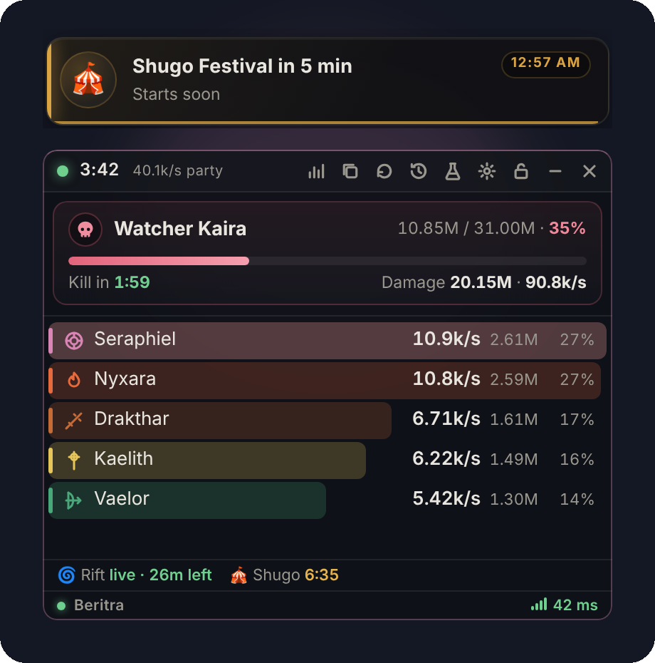

<div align="center">


# Daeva Meter

**A passive damage meter for AION 2, made by BajuBesi Labs.**
Live DPS · boss target card · skill breakdowns · event alerts · fight history

[](https://github.com/fhazal/DAEVA-dps-meter/actions/workflows/build.yml)
[](LICENSE)


[](https://discord.gg/TCmm8cH3GE)
[](https://aion2.bajubesi.org)
[](https://ko-fi.com/bajubesi)

</div>

> [!NOTE]
> Daeva Meter is an unofficial fan project by **BajuBesi Labs**. It is not affiliated with or endorsed by NCSOFT. It only **reads** your network traffic: it never injects into, modifies or talks to the game client.

<p align="center">
  
</p>

---

## ✨ Features

<table>
<tr>
<td width="50%" valign="top">

### 📊 Live overlay
DPS, total damage and share for everyone in the fight, coloured by class, in a small always-on-top window with opacity and scale. Lock it in place with `Ctrl+Shift+L`; the status light in the bottom line shows when you're fighting (green, with the fight's time) or idle (blue). Two layouts: **Classic** (the whole party) and **Solo** (just you), switch with `Ctrl+Shift+O`.

</td>
<td width="50%" valign="top">

### 🎯 Target card
The monster's portrait and name, its **type** (Cogni, Natura, Fera, Varian, Special) and **rank** colour, HP as current / max with a health bar, a **kill-time estimate**, and how long the kill took.

</td>
</tr>
<tr>
<td valign="top">

### 🔍 Details and history
Per-player skill tables (crit, back, multi-hit, parry), healing and damage taken, a DPS timeline, and every fight saved for later.

</td>
<td valign="top">

### 🔔 Event alerts
Rift, Shugo Festival, Invasion, field bosses and Gartua, straight from the [Daeva bot](https://github.com/fhazal/Daeva-aion2-discordbot)'s schedule: a countdown line under the meter, a banner and a chime before each event.

</td>
</tr>
<tr>
<td valign="top">

### 🏷️ Names and icons
Monster and skill names and game icons arrive automatically. Anything new can be named in two clicks with **✎ name it**.

</td>
<td valign="top">

### 🩺 One-key problem reports
`Ctrl+Shift+P` saves the last few minutes of game traffic as a zip on your Desktop, so bugs can be fixed from real data.

</td>
</tr>
<tr>
<td valign="top">

### 💎 Your character
Your **Odyle** energy and **Shugo Festival keys** under the meter, your server, and your **ping** to the game servers of your region (Tokyo for the Asia servers, checked once a minute: the game's own traffic goes through a nearby Cloudflare relay, which would show only a few ms). Switching characters is picked up automatically.

</td>
<td valign="top">

### 🤝 Party and summons
Summons and spirits count towards the player who summoned them. Show everyone fighting your target, just your party, or only yourself.

</td>
</tr>
</table>

<details>
<summary><b>Default hotkeys</b></summary>

| Action | Keys |
| --- | --- |
| Toggle click-through | `Ctrl+Shift+L` |
| End current fight | `Ctrl+Shift+R` |
| Hide / show overlay | `Ctrl+Shift+H` |
| Copy summary for Discord | `Ctrl+Shift+C` |
| Report a problem | `Ctrl+Shift+P` |
| Switch layout (Classic ⇄ Solo) | `Ctrl+Shift+O` |
| Research marker (testers) | `Ctrl+Shift+B` |

All of them work while the game has focus and can be changed in Settings. Research tools for testers are under **Settings → Help & feedback → Show research tools**.

</details>

---

## 🚀 Install

1. Install **[Npcap](https://npcap.com/#download)** with the default options. Leave *"Restrict Npcap driver's access to Administrators only"* **unticked**.
2. Download the latest installer (`Daeva.Meter_…_x64-setup.exe`) from **[Releases](https://github.com/fhazal/DAEVA-dps-meter/releases/latest)** and run it. It isn't code-signed yet, so Windows SmartScreen may warn you: choose **More info → Run anyway**. See our **[Code signing policy](CODE_SIGNING.md)**.

   Code signing: we plan to apply for free signing from [SignPath Foundation](https://signpath.org). Until then, installers are unsigned. See our [Code signing policy](CODE_SIGNING.md).
3. Start AION 2 in **borderless or windowed** mode, then Daeva Meter. The dot top-left turns green while it's capturing.

> [!TIP]
> From 0.3.1 the meter tells you when a new version is out (a line under the meter with a **Download** button). To update, just run the new installer over the top. If an uninstall screen ever asks, leave **"delete application data"** unticked, or you lose your settings, fight history and the names you typed.

> [!TIP]
> Start the meter **before** you enter a zone. Monsters that were already around when it started can't be identified until you change zone (they show as *Unknown monster* with a "Teleport once to identify" hint, and a notice under the meter reminds you).

---

## 🔒 Privacy

Daeva Meter only reads your network traffic; it never touches the game client. It sends nothing about you anywhere unless you use a feature that needs it (update check, monster names, event alerts, opt-in sharing), and each connection can be switched off in Settings. Full list: [Code signing policy → Privacy](CODE_SIGNING.md#privacy).

## 🩺 When something looks wrong

Press **`Ctrl+Shift+P`** (or Settings → Help & feedback → Report a problem). A `DaevaMeter-report-<time>.zip` appears on your Desktop with the last 5 minutes of game-server traffic and what the meter showed. Nothing else from your PC is included. If the meter notices the game traffic has stopped decoding, usually after a patch, a yellow warning appears under the overlay: click it for the same report.

<details>
<summary><b>Where things live on your PC</b></summary>

`%APPDATA%\org.bajubesi.daevameter\`

| File | What it is |
| --- | --- |
| `settings.json` | Your settings |
| `my-names.json` | Monster and skill names you typed. Your own database: keep it |
| `gaming-tools-names.json` | Monster and skill names (updated automatically) |
| `history\fight-*.json` | One file per finished fight |
| `definitions\` | Drop an updated `aion2.json` here after a game patch |

</details>

---

## 🛠️ Building

<details>
<summary><b>Project layout and build steps</b></summary>

| Path | What it is |
| --- | --- |
| `crates/meter-core` | Capture parsing, TCP reassembly, protocol decoder, combat engine (no dependencies, any OS) |
| `crates/research` | `daeva-research` CLI for decoding captures |
| `app/` | Windows app (Tauri 2 + WebView2); the overlay UI is in `app/ui` |
| `definitions/aion2.json` | The protocol, as data: after a patch you update this file, not the app |

Every push builds the Windows installer on GitHub Actions. To build on your own PC (Windows 10/11, with [Rust](https://rustup.rs) and Node.js 20+):

```powershell
cargo test --workspace
cd app
npx @tauri-apps/cli@2 dev      # run with hot reload
npx @tauri-apps/cli@2 build    # installer in app/src-tauri/target/release/bundle/nsis/
```

More: [docs/DECODING.md](docs/DECODING.md) · [docs/DEFINITIONS.md](docs/DEFINITIONS.md) · [docs/BOT_API.md](docs/BOT_API.md)

</details>

---

## 🗺️ Roadmap

- 💎 Loot decoding and rare-drop cards in Discord
- 🏆 Daeva bot leaderboards: top DPS of the day, most active players
- ⏳ Buff uptime and a death recap
- ⬆️ Releases page with automatic update checks

---

## 🙏 Credits

- **[AION 2 Global Database](https://aion2.gaming.tools)** by gaming.tools: monster and skill names and game icons, with thanks to their team.
- **[Lucide](https://lucide.dev)** (ISC licence): the icon set used throughout the meter.
- **[Daeva](https://github.com/fhazal/Daeva-aion2-discordbot)**, our Discord assistant, supplies the event schedule.
- Released under the [MIT licence](LICENSE).

<div align="center">

<sub>Made with ☕ by <b>BajuBesi Labs</b> · AION 2 and its artwork belong to NCSOFT Corporation.</sub>

</div>
